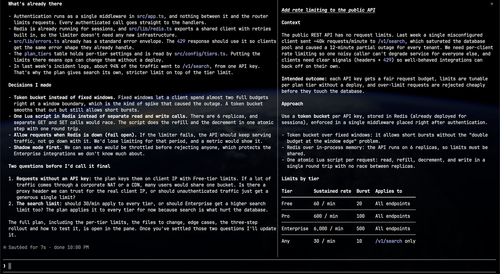

# plan-view

A Claude Code plugin that shows Claude's plan in a pane beside the chat and updates it live while Claude writes it in plan mode.



## Install

In Claude Code:

```
/plugin install plan-view --marketplace yukisaitoo/claude-code-plan-view
```

Or from a shell:

```
claude plugin install plan-view --marketplace yukisaitoo/claude-code-plan-view
```

Update with `claude plugin update plan-view@plan-view`, then restart Claude Code. Or turn on auto-update in `/plugin` → Marketplaces → plan-view.

## Usage

Switch to plan mode (shift+tab) and ask for a plan. The pane opens on its own beside the chat when your terminal is wide enough (about 144 columns). If it doesn't, run `/tui fullscreen` once.

- `/plan-view` opens the pane, including in narrower terminals or other layouts.
- The pane only displays the plan. It doesn't change how Claude plans.

## Settings

Change these in `/config`.

| Setting            | Default | Options                                                   |
| ------------------ | ------- | --------------------------------------------------------- |
| Open automatically | on      | Off: only `/plan-view` opens the pane                     |
| Pane width         | wide    | narrow (~30%), medium (~38%), wide (~45%) of the terminal |

## Stored data

The plugin remembers each session's plan file path and pane state (last 100 sessions) under your Claude Code config directory. It never stores plan contents.

## License

MIT

## Development

```
claude --plugin-dir .         # loads this folder in place of the installed copy; /reload-plugins after edits
npm install && npm run check  # types, format, validate, tests
```

Start the `--plugin-dir` session once before `npm run check`: it generates the type definitions the type-check needs.

To test the installed copy before a release, add the marketplace from this folder (`claude plugin marketplace add ./`), bump `version` in `.claude-plugin/plugin.json`, run `claude plugin update plan-view@plan-view`, and restart Claude Code. Installed copies are cached per version under `~/.claude/plugins/cache/`.
